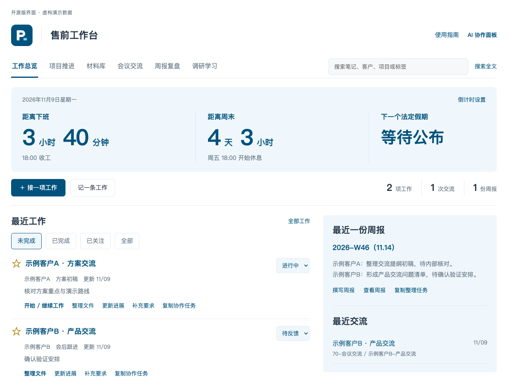
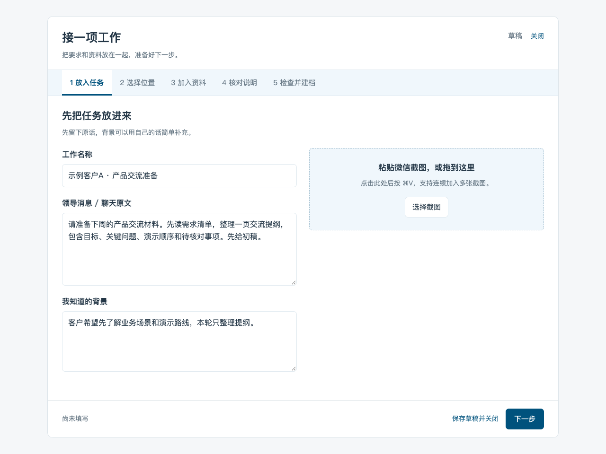
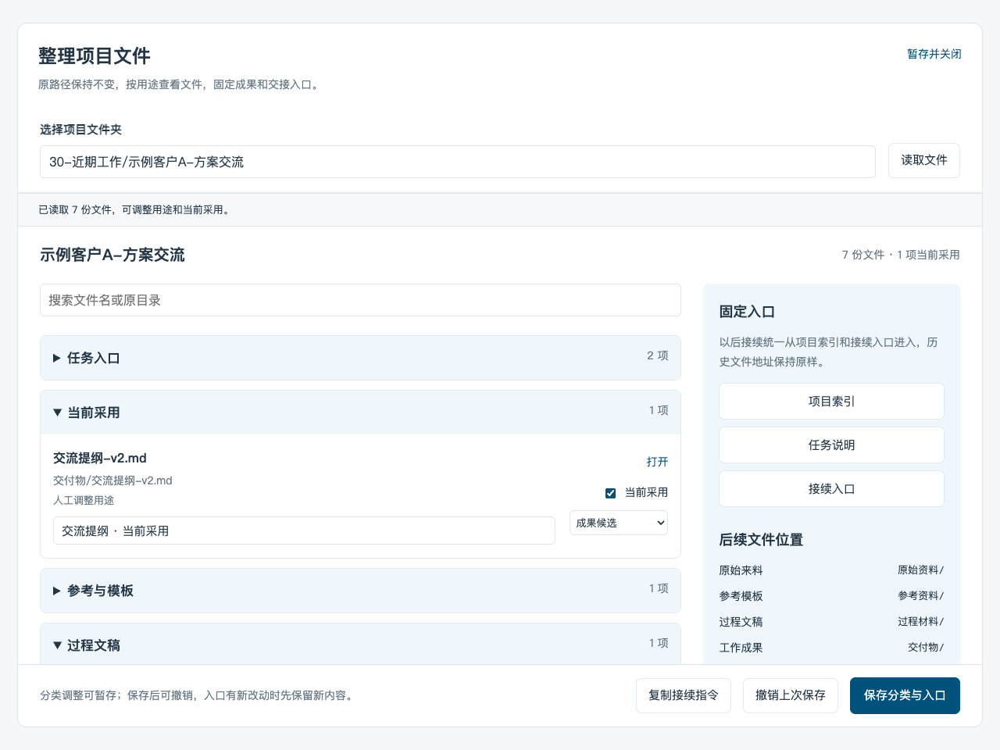
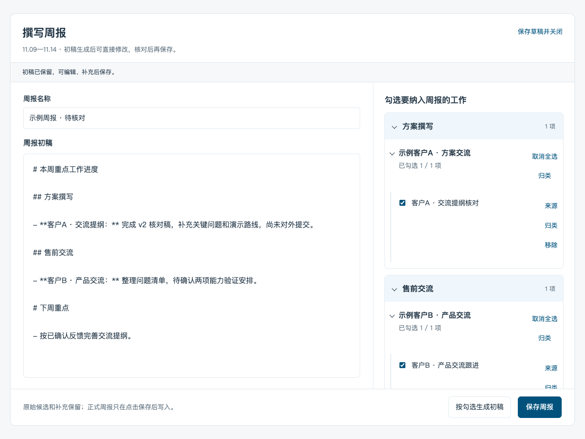

# Obsidian 售前工作台

**把客户消息、参考材料、AI 任务和周报，串成一条可追溯的工作流。**


[](https://github.com/Jiale077/obsidian-presales-workbench/actions/workflows/ci.yml) [](LICENSE)

[看工作台](#工作台长什么样) · [安装试用](#快速开始先打开演示库) · [第一次使用](#第一次使用从接任务到写周报) · [完整图文教程](docs/getting-started.md) · [常见问题](#常见问题)

## 它能帮你做什么

适合经常处理客户交流、方案材料、项目交付和工作周报的售前工程师，也适合希望用本地知识库组织工作的个人。

| 你手里的工作 | 在工作台里怎么做 | 留下什么 |
| --- | --- | --- |
| 聊天里来了一个任务，还带着截图和附件 | 收集原话、加入材料，整理并核对任务说明 | `说明.md`、来源材料、项目索引 |
| 同一份方案要改好几轮 | 在项目里开始 / 继续 AI 工作，补充要求 | 同一任务会话、成果文件、执行记录 |
| 初稿、采用稿和交接散在多个目录 | 按用途查看，人工指定当前采用与接续入口 | 原路径上的文件和清楚的项目导航 |
| 到周末想不起具体做了什么 | 收集本周线索，选入候选，按项目归并 | 可编辑、可核对的周报初稿 |

**不用 AI 也能先用起来：** 浏览材料、手动建档、维护项目进度、整理文件和填写记录都可以先做。AI 整理说明、持续执行和自动起草周报，需要另行配置自己的 Codex CLI。

## 工作台长什么样



首页把**项目状态、下一步、最近交流、周报和常用材料**放在一起。六个分区分别是工作总览、项目推进、材料库、会议交流、周报复盘、调研学习。

> 截图由开源版界面源码渲染，使用虚构客户和演示资料。周报中的示例正文为手工填写，用于展示编辑流程；不代表此次运行真实模型的产出。封面是「Jiale的AI工坊」风格的概念插图，工作台本身保留蓝白界面。

## 快速开始：先打开演示库

### 1. 下载并生成演示库

基础工作台需要 **macOS 上的 Obsidian 桌面端 + Dataview**。以下安装命令使用 Python 3.11+；试用手动功能时，暂时不需要 Codex。

在终端依次运行：

```bash
git clone https://github.com/Jiale077/obsidian-presales-workbench.git
cd obsidian-presales-workbench
python3 scripts/install.py --vault "../售前工作台演示" --demo
```

完成后，仓库旁边会出现 `售前工作台演示` 文件夹，里面有工作台、虚构项目和示例周报。

<details>
<summary>没有安装 Git？也可以下载 ZIP</summary>

下载[当前源码 ZIP](https://github.com/Jiale077/obsidian-presales-workbench/archive/refs/heads/main.zip)，解压后在该目录打开终端，运行：

```bash
python3 scripts/install.py --vault "../售前工作台演示" --demo
```

</details>

### 2. 在 Obsidian 打开并启用视图

1. 在 Obsidian 选择**打开本地仓库 / 打开文件夹作为仓库**，选择刚生成的 `售前工作台演示`。
2. 打开**设置 → 第三方插件**，搜索、安装并启用 **Dataview**；在 Dataview 设置中开启 **JavaScript Queries**。
3. 打开**设置 → 外观 → CSS 代码片段**，启用 `presales-workbench`。没有看到时，刷新代码片段列表。
4. 打开 `售前工作台.md`，切换到**阅读视图**。

**看到两个虚构项目和示例周报，就可以开始试用了。** 如果页面只显示一段代码，查看下方[常见问题](#常见问题)。

### 3. 先试一个小任务

点击 **「接一项工作」**，可以用下面这段虚构任务练手：

```text
为示例客户A准备一次产品交流。
先读需求清单，整理一页交流提纲：
交流目标、3个关键问题、演示顺序和待核对事项。
成果放在“交付物/”，先给我初稿。
```

还没有配置 AI 时，在**「加入资料」→「手动填写」**中补充本次动作和交付物，再检查并保存。完整步骤见[第一次建档教程](docs/getting-started.md#2-先完成一次手动建档)。

> 想放进已有知识库时，先用 `--dry-run` 检查安装计划。遇到不同内容的同名文件，安装会整体停止；首版不会自动迁移你原有的目录结构。建议先在独立演示库熟悉流程。

## 第一次使用：从接任务到写周报

### ① 收任务：原话、截图和材料放在一起



五步分别是 **放入任务 → 选择位置 → 加入资料 → 核对说明 → 检查并建档**。

可以新建任务、在原项目下新开一轮，也可以补充已有要求。外部材料保存为副本，库内资料建立引用；没收集完可以保存草稿，下次继续。

### ② 核对说明，再开始 AI 工作

先按 [Codex CLI 官方说明](https://developers.openai.com/codex/cli/)安装 CLI，并完成自己的登录。可在终端检查：

```bash
codex --version
codex login status
```

未登录时运行 `codex login`，按浏览器提示完成登录；详见[官方认证说明](https://developers.openai.com/codex/auth/)。

然后回到工作台：

1. 在「加入资料」点击 **识别并进入核对**。
2. 检查说明正文、来源和待核对事项；可直接编辑，也可让 AI 按意见修改。
3. 点击 **采用草稿并继续**，检查后保存。
4. 在建档结果或项目卡片点击 **开始 / 继续工作**。

后续在同一项目补充修改要求，会继续该任务的会话。面板显示本轮进度、问题和文件；需要停止时点「停止本轮」。**关闭面板后，正在运行的工作仍可能继续。**

如果 Obsidian 找不到 Python 或 Codex，把本机命令路径填入安装后的 `90-其他/工作台/runtime-config.json`，见[配置示例](docs/getting-started.md#3-接入自己的-codex)。

### ③ 整理文件：明确哪一份正在用



项目卡片点 **整理文件**，按来料、参考、过程、成果、交接等用途查看；手动勾选**当前采用**，再点 **保存分类与入口**。

它维护索引和接续导航，保留原文件路径。文件名写着“最终版”，或修改时间更新，都不会自动让它成为采用稿。

### ④ 写周报：选工作、改正文、再保存



进入 **周报复盘**，刷新本周线索，用「＋」选入候选并核对分类，再点 **撰写周报**。可以手动写正文，也可以使用 Codex 按勾选内容生成初稿；补充线下工作、修改措辞后再保存。

文件变化只作线索。默认不读取本机 Codex 历史；已有同名周报时，会追加本轮初稿区，保留原文。

## 任务和成果存在哪里

每项工作仍是本地文件，可以直接用 Obsidian 或文件管理器打开：

```text
30-近期工作/一个任务/
├── 说明.md                 本轮要求、来源和已核对说明
├── 📂 索引.md              项目状态、下一步和采用入口
├── 聊天截图/               原始消息
├── 原始资料/               来稿、附件、录音
├── 参考资料/               模板与参考
├── 过程材料/               大纲、核验和修改记录
├── 交付物/                 本轮成果
├── 会话交接/               累计背景与接续入口
└── 工作记录/               执行后生成的记录
```

新任务默认使用这套约定；已有项目有目录约定时沿用原位置。后台状态和周报候选分别放在 `.workbench/`、`.weekly/`，不应上传到公开仓库。

## 常见问题

| 遇到的情况 | 怎么处理 |
| --- | --- |
| 只看到 `dataviewjs` 代码 | 切到阅读视图，确认 Dataview 已启用、JavaScript Queries 已开启 |
| 页面有内容，但样式很乱 | 在外观中启用 `presales-workbench` CSS 代码片段 |
| 还没有 Codex，能用吗？ | 可以先手动建档、浏览、整理文件、维护进度和填写记录；AI 按钮需配置后使用 |
| AI 按钮提示找不到环境 | 检查 Python 3.11+、Codex CLI 和登录状态，必要时填写本机命令的完整路径 |
| 安装提示同名文件冲突 | 原文件会保留；先用新目录试用，再按需手动合并，不要直接覆盖个人定制版 |
| 能在 Windows / 手机上用吗？ | 首版面向 macOS 桌面端；Linux 后台通过离线测试，完整界面尚未实机验证；Windows、移动端暂不支持 |
| 为什么没看到录音转录或 Office 预览？ | 它们需要额外工具或插件，按[可选能力说明](docs/configuration.md)单独配置 |

更详细的步骤见[完整图文教程](docs/getting-started.md)，日常操作见[工作台指南](vault/_MOC/工作台使用指南.md)。

## 可选能力与数据范围

- **文档正文**：可选本机 MarkItDown；**本机录音转录**：Apple Silicon Mac 可选 MLX Whisper 和 FFmpeg。也可以直接加入已有转录与 Markdown 正文。
- **云端转录 / 解析、Word 预览、AI 侧栏**需独立配置。PPT 预览和每日定时刷新不随本仓库自动安装。
- 原始文件与记录保存在自己的知识库。调用 AI 时，选定内容会发送给自己的模型服务；选择云端转录或解析时，相关文件会上传到该服务。
- 工作台使用自己的 Codex 登录与用量。文件生成、初稿保存和一轮执行结束，均不代表已对外提交、已验收或项目整体完成。

[配置说明](docs/configuration.md) · [架构与目录](docs/architecture.md) · [验证范围](docs/verification.md)

## 开发、贡献与许可

当前为 `v0.1.0` 公共版本，主界面采用 Dataview JavaScript 和 CSS，尚未做成单独的社区插件。Codex app-server 为实验接口；当前核对 CLI 为 `0.167.0-alpha.3.2`，兼容范围见[验证记录](docs/verification.md)。

```bash
python3 -m unittest discover -s tests -v
node --test tests/core.test.cjs
python3 scripts/check_release.py
```

欢迎提交 [Issue](https://github.com/Jiale077/obsidian-presales-workbench/issues) 和改进，复现材料请使用虚构数据。[参与贡献](CONTRIBUTING.md) · [MIT License](LICENSE) · [来源与致谢](NOTICE.md)

配图采用「Jiale的AI工坊」的暖白、炭黑、珊瑚橙视觉语言；[配图与截图说明](docs/images/README.md)。
