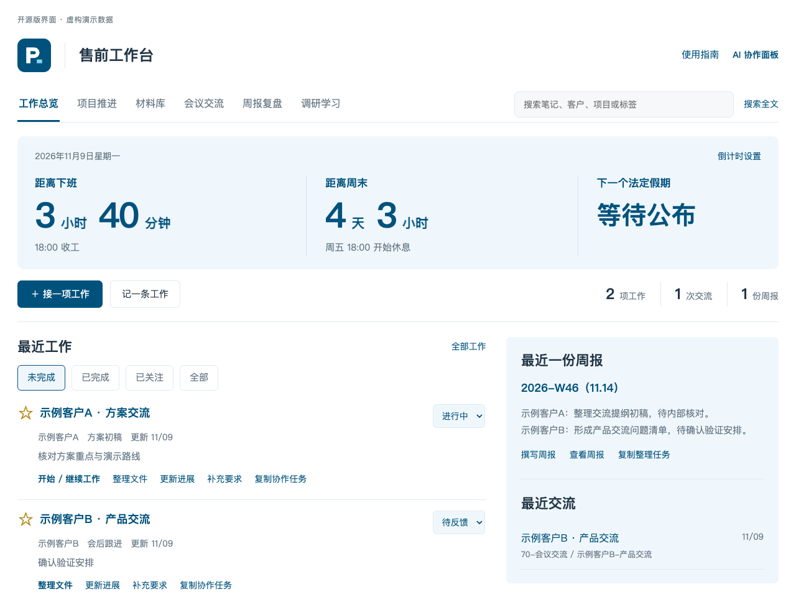
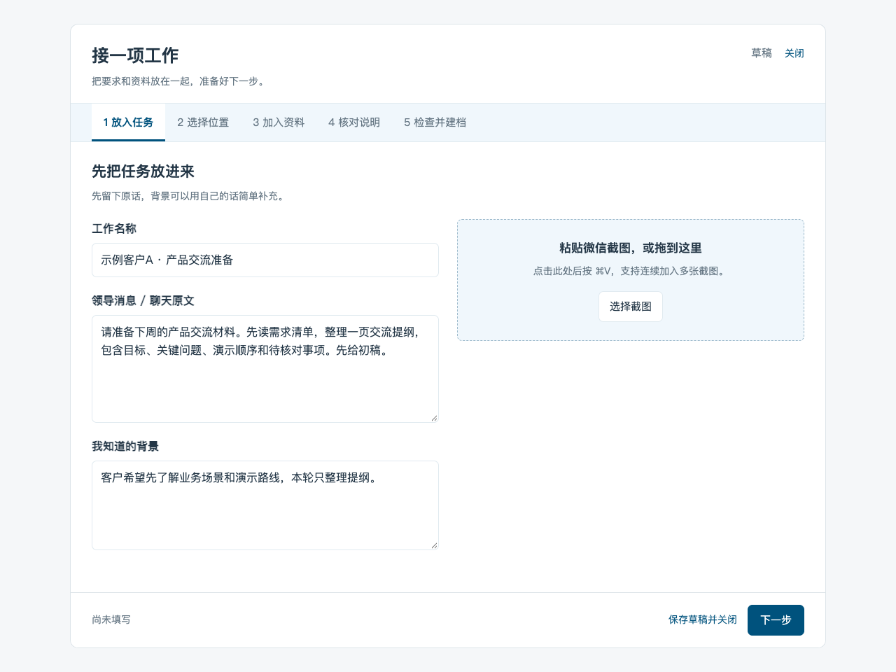
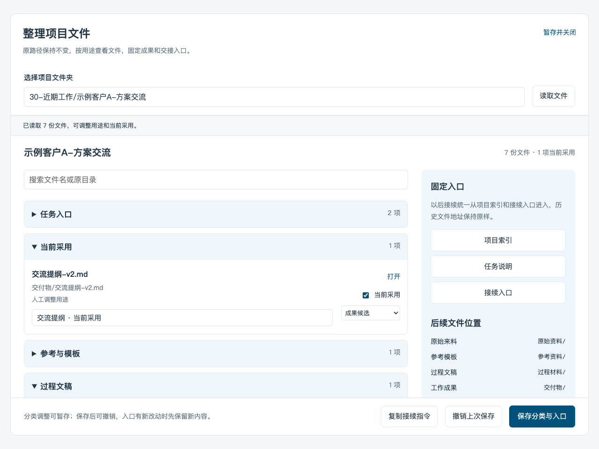
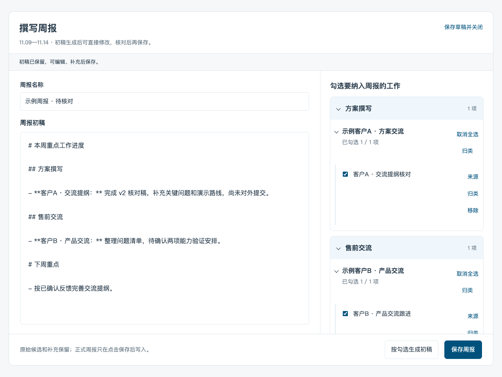

# 第一次使用：从一条消息到一份成果

这篇教程用虚构客户演示完整路径。建议先用独立演示库；基础操作可手动完成，配置自己的 Codex 后再试 AI 功能。

## 1. 把演示库打开

准备 **macOS Obsidian 桌面端、Python 3.11+**。

```bash
git clone https://github.com/Jiale077/obsidian-presales-workbench.git
cd obsidian-presales-workbench
python3 scripts/install.py --vault "../售前工作台演示" --demo
```

没有 Git 时，下载[当前源码 ZIP](https://github.com/Jiale077/obsidian-presales-workbench/archive/refs/heads/main.zip)，解压并在根目录打开终端，执行最后一行。

在 Obsidian 中：

1. 选择“打开本地仓库 / 打开文件夹作为仓库”，打开 `售前工作台演示`。
2. 在“设置 → 第三方插件”安装并启用 Dataview。
3. 在 Dataview 的设置中开启 JavaScript Queries。
4. 在“设置 → 外观 → CSS 代码片段”启用 `presales-workbench`。
5. 打开 `售前工作台.md`，切到阅读视图。



首页应有两个虚构项目和一份示例周报。项目星标、状态、阶段和下一步都可以在后续使用中维护。

## 2. 先完成一次手动建档

先试不调用模型的流程，熟悉任务和文件如何保存。

点击首页 **接一项工作**，按下面五步操作：

| 步骤 | 填写 / 操作 | 这一步的作用 |
| --- | --- | --- |
| 放入任务 | 工作名填“示例客户C · 交流提纲”，粘贴原始要求，可加入聊天截图 | 保留原话与自己的补充 |
| 选择位置 | 选“新建一项工作 → 近期工作”，客户可填“示例客户C” | 确定项目文件夹 |
| 加入资料 | 可关联演示库的需求清单；先试手动流程时点击“手动填写” | 说明每份材料用于什么 |
| 核对说明 | 填本次先做什么、交付物和明确要求；不确定项可以留空 | 明确本轮动作 |
| 检查并建档 | 检查目录与正文，点“确认并保存说明” | 正式创建说明与索引 |

可以用这段要求练手：

```text
为示例客户C准备一次产品交流。
先阅读参考需求清单，整理一页交流提纲：
交流目标、3个关键问题、演示顺序和待核对事项。
先提供 Markdown 初稿，成果放在“交付物/”。
```



建档后会打开 `说明.md`。回到工作台，项目卡片里可以查看任务、更新进度、补充要求。没收集完时选择“保存草稿并关闭”，之后从“草稿”继续。

**外部文件保存为副本，库内资料建立引用。** 新要求可以追加到已有任务；需要独立的一轮修改时，在原项目下新建一轮工作。

## 3. 接入自己的 Codex

AI 整理、持续执行和按候选起草周报需要 **Python 3.11+、Codex CLI 和自己的登录**。按 [Codex CLI 官方说明](https://developers.openai.com/codex/cli/)完成安装，然后在终端检查：

```bash
python3 --version
codex --version
codex login status
```

未登录时运行 `codex login`，按浏览器提示完成登录；[官方认证说明](https://developers.openai.com/codex/auth/)介绍了登录和状态检查。模型使用自己的账号与用量，项目不提供免费模型服务。

### Obsidian 找不到本机命令时

在终端运行：

```bash
command -v python3
command -v codex
```

把结果分别填入安装后知识库中的 `90-其他/工作台/runtime-config.json`：

```json
{
  "python_command": "/你的 Python 完整路径/python3",
  "codex_command": "/你的 Codex 完整路径/codex",
  "codex_model": "",
  "include_codex_history": false,
  "document_provider": "local"
}
```

留空时自动查找。这里填写的是可执行文件路径，不是带参数的整行命令；也不需要填密码或 API Key。完整字段见[配置说明](configuration.md)。

### 让 AI 整理任务说明

回到任务收集的“加入资料”页，点击 **识别并进入核对**。结果返回后：

1. 阅读说明正文，确认本轮动作、交付物、范围和时限。
2. 检查“来源与待核对”，对照原文确认姓名、数字和未读材料。
3. 可直接改正文，也可以在“告诉 AI 你想怎么改”输入调整意见。
4. 点 **采用草稿并继续**，再检查并建档。

可直接加入已有转录稿和 Markdown。录音转录、复杂文档提取依赖额外工具，未配置时先用已整理的文字材料试通流程。

## 4. 开始执行，再继续修改

在建档结果或有 `说明.md` 的项目卡片点击 **开始 / 继续工作**。工作台读取说明与相关资料，在该任务文件夹执行本轮要求。

- 在面板看进度、真实问题和“本轮文件”。
- 需要补充信息或确认操作时，在面板答复。
- 本轮结束后，可以输入“把交流提纲压缩到一页，保留待核对问题”等修改要求，继续同一任务会话。
- 需要中止时点“停止本轮”；关闭面板不等于停止后台执行。电脑需保持运行。

正式成果默认放在任务的 `交付物/`，执行记录放在 `工作记录/`。已有项目明确指定其他位置时沿用约定。完成一轮之后，仍需核对实际成果和项目状态。

## 5. 让文件和采用入口清楚起来

项目卡片点 **整理文件**，选择具体项目。按用途查看文件，再手动勾选“当前采用”。



例如，你可以保留 `交流提纲-v1.md`，将 `交流提纲-v2.md` 标为“交流提纲 · 当前采用”。点击 **保存分类与入口** 后，项目索引会更新采用链接和接续导航；原文件保留在原路径。

“当前采用”由人选择，不根据日期或“最终版”文件名自动判断。“撤销上次保存”会检查入口是否又有新修改，有新内容时先保护它，避免覆盖其他人的补充。

## 6. 把本周工作整理成周报

1. 进入 **周报复盘**。首次进入收集本库文件线索，之后可以点“刷新本周工作”。
2. 展开类别与项目，用 **＋** 加入候选。线下工作可用“补充一条”记录。
3. 核对候选名称、归类、项目和实际进度，勾选本轮需要写入的内容。
4. 点 **撰写周报**。可手动填写正文；配置 Codex 后，也可以按勾选内容生成初稿。
5. 补充下周计划、修改正文，核对后点 **保存周报**。



已有同名周报时，按钮会提示追加，原文保留。文件变化只是查找线索，不自动代表业务成果；默认不读取本机 Codex 历史。

## 7. 安装到自己的工作库之前

先检查安装计划：

```bash
python3 scripts/install.py --vault "/你的知识库路径" --dry-run
```

首版采用通用中文目录，安装工具不会迁移旧资料。发现不同内容的同名首页、规则或代码时，会在写入前整体停止。个人定制工作台应按需手动合并。

如果已经安装 Dataview，可以关闭目标库，再用 `--enable-settings` 备份并合并 CSS、JavaScript 查询和插件启用设置。这个选项会修改设置文件，备份在 `.presales-workbench-backups/`。

可选 Word 预览、云端转录、文档解析以及其他配置，见[配置说明](configuration.md)。首版支持范围与测试边界见[验证记录](verification.md)。

## 截图说明

以上图片来自开源版界面源码，使用虚构演示数据生成。截图中的周报正文为手工填入的示例，未将模型模拟结果当作真实执行成果。截图展示完整流程中的几个界面，不能替代所有环境的兼容验证。
